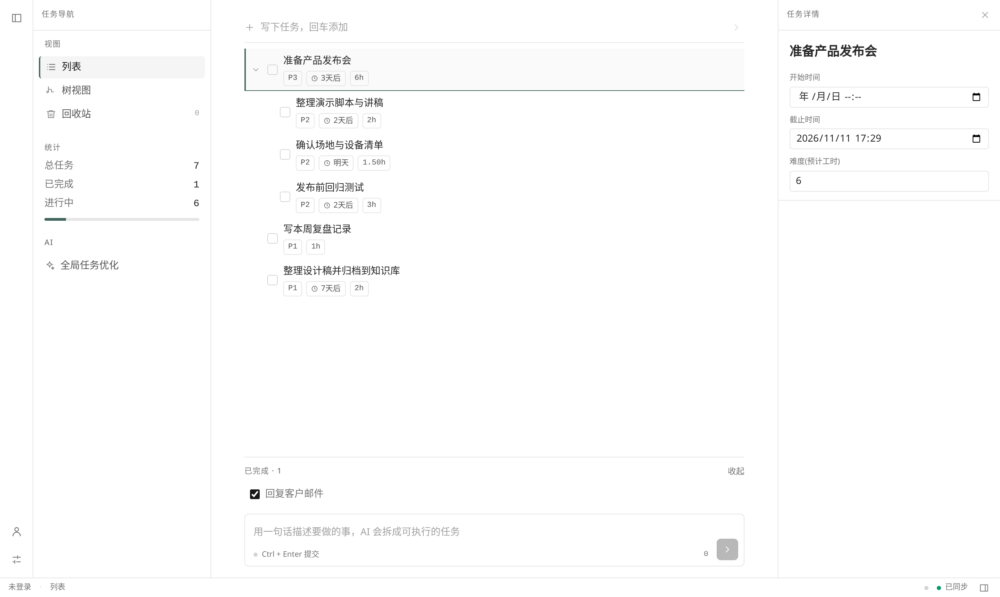

# TodoHeap 任务堆

TodoHeap 是一个智能任务管理工具，旨在帮助用户将模糊的任务转化为精确的日程;

AI 介入管理多任务的复杂性，帮助用户摆脱拖延症、选择困难症，专心做一个行动者。

## 快速链接

- **应用链接**: https://sherlocknieh.github.io/TodoHeap/

## 项目简介

- **核心功能**: 在传统 TodoList 上增加对话 Agent, 用一句话完成拆解、排程与整理, 减轻人脑在任务管理上耗费的精力;

- **特色功能**: 以思维导图方式展示和管理任务树, 帮助你高效地整理思路;

- **特色功能**: 支持 ICS 导入导出, 并可生成只读订阅链接供系统日历自动同步;

## 开发指南

依赖环境: 

- `Node.js`: 
- `nub` : curl -fsSL https://nubjs.com/install.sh | bash

前端: [Vue 3](./frontend/README.md)
后端: [Supabase](./supabase/README.md)
文档: [Astro Starlight](./docs/README.md)